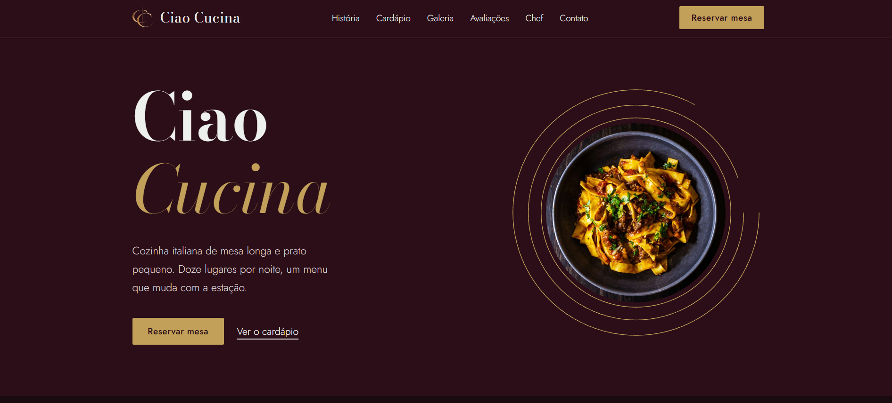
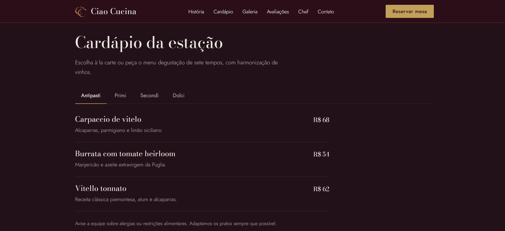
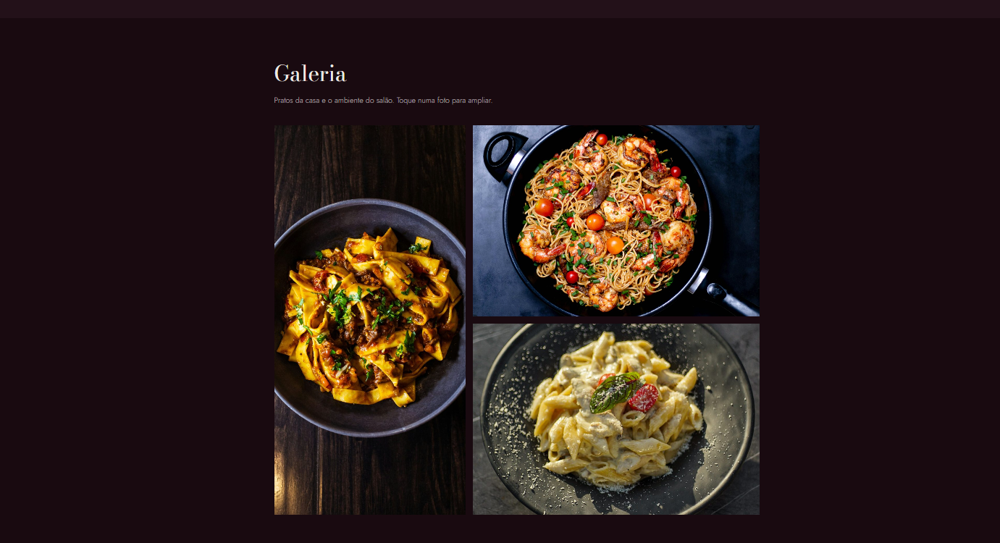

# Ciao Cucina
 
Site de um restaurante fictício de alta gastronomia italiana, criado como projeto de portfólio para apresentar a clientes. O foco é mostrar design refinado, interação e boas práticas de acessibilidade usando apenas HTML, CSS e JavaScript.
 
> **Aviso:** o restaurante, os nomes, o endereço, os preços e os depoimentos são fictícios.
 
**Site publicado:** [ciaocucina.netlify.app](https://ciaocucina.netlify.app)
**Autor:** Gabriel · [LinkedIn](#) · [GitHub](https://github.com/Gabzolas)
 
## Prévia
 



## O que o site tem
 
- **Hero** com a foto de um prato dentro de anéis dourados, que se desenham ao abrir a página
- **História** do restaurante, com os principais números da casa
- **Cardápio em abas** (Antipasti, Primi, Secondi e Dolci), gerado a partir de dados em JavaScript
- **Galeria com lightbox**, com navegação por botões, setas do teclado e Esc para fechar
- **Avaliações**: depoimentos em destaque e formulário com nota em estrelas e validação
- **Reservas**: formulário com validação de nome, e-mail, data, horário e número de pessoas
- **Tema claro e escuro**, que acompanha a configuração do aparelho
## Tecnologias
 
- HTML5 semântico
- CSS3: variáveis (custom properties), grid, flexbox e media queries
- JavaScript puro, sem bibliotecas
- Fontes Bodoni Moda e Jost, via Google Fonts
## Decisões de design
 
- **Paleta:** vinho profundo, dourado fosco e mármore claro, para transmitir sofisticação sem recorrer ao verde, branco e vermelho da bandeira italiana
- **Tipografia:** Bodoni Moda nos títulos (o estilo nasceu na Itália) e Jost no texto corrido, em contraste claro
- **Respiro:** poucas informações por tela, muito espaço em branco e fotos grandes
- **Movimento:** uma única animação de abertura (os anéis do hero), sem efeitos espalhados pela página
- **Menu no celular:** em telas pequenas o menu mostra só o botão "Reservar mesa", para manter a navegação limpa e levar o visitante direto à reserva
## Acessibilidade
 
- Link "Ir para o conteúdo" para quem navega por teclado
- Estrutura semântica (`header`, `nav`, `main`, `section`, `footer`)
- Navegação completa por teclado, inclusive nas abas do cardápio (setas) e no lightbox
- Texto alternativo em todas as imagens e rótulos em todos os campos de formulário
- Mensagens de erro e de confirmação anunciadas a leitores de tela (`aria-live` e `role="status"`)
- Foco visível e respeito à preferência de movimento reduzido
- Contraste de cores verificado entre texto e fundo
## Estrutura do projeto
 
```
ciao-cucina/
├── index.html
├── README.md
├── assets/
│   ├── css/
│   │   ├── variables.css      # cores, fontes e tema claro/escuro
│   │   ├── base.css           # estilos globais
│   │   ├── components.css    # menu, botão e rodapé
│   │   └── pages/
│   │       ├── home.css       # hero, história, cardápio, chef e reservas
│   │       ├── gallery.css    # galeria e lightbox
│   │       └── reviews.css    # avaliações
│   ├── js/
│   │   ├── cardapio.js        # abas do cardápio
│   │   ├── reservas.js        # validação das reservas
│   │   ├── gallery.js         # lightbox
│   │   └── avaliacoes.js      # validação das avaliações
│   └── images/
│       ├── branding/          # logotipo e monograma
│       └── galeria/           # fotos dos pratos
└── docs/
    ├── wireframes/
    └── prints/
```
 
## Como abrir
 
Abra o `index.html` no navegador. Para recarregar a página a cada alteração, use a extensão Live Server no VS Code.
 
## Limitações e próximos passos
 
- Os formulários de reserva e de avaliação funcionam só no navegador: validam os dados e confirmam o envio, mas não guardam nada. Como o site é uma apresentação, não há back-end por enquanto.
- As imagens não foram otimizadas para desempenho (por exemplo, conversão para WebP ou versões em tamanhos diferentes para cada tela), por se tratar de um projeto de portfólio de exemplo. Elas deixam a página mais pesada, o que pode reduzir a nota de desempenho no Lighthouse. Em um site real, esse seria um dos primeiros ajustes.
- Páginas separadas para cardápio, chef e contato podem ser criadas a partir da estrutura atual.
- Medir e registrar as notas do Lighthouse: [preencher após a medição]
## Créditos
 
- Logotipo: criação própria do projeto
- Fotos dos pratos: Nicholas Grande, Olayinka Babalola e Kimia Kazemi, via [Unsplash](https://unsplash.com)
- Fontes: [Bodoni Moda](https://fonts.google.com/specimen/Bodoni+Moda) e [Jost](https://fonts.google.com/specimen/Jost), via Google Fonts
